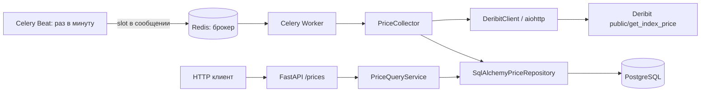

# Архитектура

## Границы кода

| Модуль | Ответственность |
| --- | --- |
| `domain.py` | Неизменяемая цена, тикеры, ошибки и Protocol-порты |
| `services.py` | Сбор валют, частичный успех, получение истории и преобразование дней UTC |
| `infrastructure/deribit.py` | HTTP, JSON-RPC, проверка ответа, точность Decimal |
| `infrastructure/database.py` | ORM-модель, запросы, транзакции, атомарная запись |
| `api/` | Query-валидация, сериализация, HTTP-коды и фабрика FastAPI |
| `worker.py` | Фабрика Celery, минутный слот, повторы и управление ресурсами задачи |
| `settings.py` | Валидируемая конфигурация из окружения |
| `migrations/` | Версионируемая схема PostgreSQL |

Сервисы зависят от интерфейсов `PriceRepository`, `IndexPriceClient` и `Clock`.
Инфраструктурные адаптеры реализуют эти интерфейсы структурно, без наследования ради наследования.
HTTP-обработчики не содержат SQL или обращения к бирже.

Объекты приложения создаются фабриками `create_app()` и `create_celery_app()`.
Глобальных экземпляров приложения, настроек, клиента, сессии или соединения в проекте нет.
FastAPI хранит принадлежащий ему сервис в `app.state`, отдавая его через dependency injection.
Классы, функции и идентификаторы миграций на уровне модуля — объявления, а не глобальное состояние.

## Жизненный цикл

API создаёт engine и фабрику сессий в lifespan и освобождает engine при остановке.
Репозиторий открывает отдельную короткую сессию на операцию. Запись коммитится внутри `save()`;
при ошибке транзакция откатывается.

Celery запускает обычную синхронную задачу. Внутри задачи `asyncio.run()` создаёт event loop,
а `collect_prices()` создаёт engine и aiohttp-сессию. В конце оба ресурса освобождаются.
Engine задачи использует `NullPool`: соединения не переходят между процессами или event loop.

Две валюты опрашиваются параллельно. Для каждой используется собственная DB-сессия.
Сбор дожидается обоих результатов, включая исключения, перед освобождением ресурсов.

## Схема данных

Таблица `prices`:

| Поле | PostgreSQL | Значение |
| --- | --- | --- |
| `id` | BIGINT, primary key | Внутренний идентификатор |
| `ticker` | VARCHAR(7) | `btc_usd` или `eth_usd` |
| `price` | NUMERIC(28, 12) | Положительная цена индекса |
| `timestamp` | BIGINT | UNIX seconds на момент получения цены |
| `collection_slot` | BIGINT | Начало минутного запуска, UNIX seconds |

Уникальность `(ticker, collection_slot)` обеспечивает одну запись валюты за запуск.
`INSERT ... ON CONFLICT DO NOTHING` защищает от гонки между воркерами.
Индекс `(ticker, timestamp, id)` обслуживает историю и последнюю цену;
`id` задаёт стабильный порядок при одинаковом времени наблюдения.
CHECK-ограничения проверяют тикер, положительную цену, неотрицательное время и кратность слота 60.

## Процессы

Compose содержит пять постоянных сервисов: API, Worker, Beat, PostgreSQL и Redis.
Шестой сервис `migrate` выполняет миграцию и завершается. API, Worker и Beat запускаются
после её успешного завершения. Код приложения использует один Docker image.
